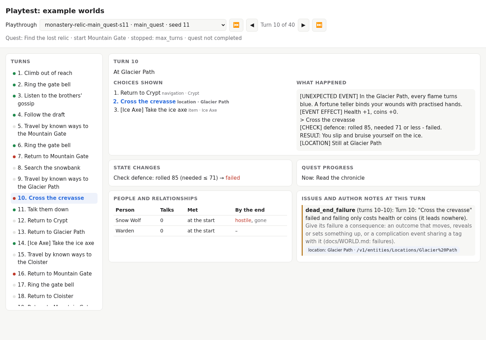

# Gameplay playtest and narrative quality evaluation, 2026-11-25

This report has two parts:

- **Offline playtests.** Simulated players played the example worlds (Frozen Monastery, Orbital Station)
  using `evaluator/playtest.py`. 24 scenarios were run with no training. A sample of 6 was read by the
  language-model judge.
- **Live UI playtests.** A browser (Playwright, headless Chromium) played the deployed studio at
  <https://ane-ui.hamlet.iti.gr/?section=play>: 8 games, 189 turns.

Automated measures (counts and checks of what the engine recorded) and the judge's view (a subjective
reading) are reported separately throughout.

## Summary

| | Result |
| --- | --- |
| Offline scenarios | 24 (2 worlds × 6 strategies × 2 seeds, plus 2 glacier-start scenarios); 778 turns; about 10 s |
| Softlocks, contradictions, impossible objectives | **none** in either example world |
| World checks | 1 warning: Orbital Station's `reach_observatory` can never be chosen from the default start |
| Weak segments for authors | 22 failures that lead nowhere, 11 filler stretches, 8 action loops |
| Judge sample (6 playthroughs) | engagement 5–8; **character development lowest everywhere (3–5)**; coherence 7–8.5 |
| Live games | 8 games, 189 turns; 2 won, 1 death, 5 stopped at the turn limit; mean turn response 2.2 s |
| Verified UI bugs | 2 medium (raw `[EPILOGUE]` tag in the ending banner; wrong stat bonuses), 3 low, plus design issues |
| Example worlds on the deployed site | **not available**: only harbour-city engines are deployed, so the live tests used those |

## 1. Offline playtests (simulated players)

### Setup

The scenarios are in [`evaluator/scenarios/side_content.yaml`](../../../evaluator/scenarios/side_content.yaml).

- **Frozen Monastery:** quest `return_the_relic` from Mountain Gate, and a free quest from Glacier Path
  (the side-quest and thieves route).
- **Orbital Station:** quest `reboot_reactor` from Docking Bay.
- **Storytellers:** random, drawn from each seed.
- **Length:** up to 40 turns.
- **Strategies:** `main_quest`, `explorer`, `side_quest`, `combat`, `conflict_avoiding`, `random`.

The full generated report is [offline-report.md](offline-report.md).

```bash
python -m evaluator.playtest evaluator/scenarios/side_content.yaml --out playtest-out
```

### Automated measures by world and strategy

| World | Strategy | Runs | Quest done | Mean turns | Meaningful choices | Filler | Backtracks | Repeated actions | Attacks / 10 turns | Side quests accepted / done |
| --- | --- | --- | --- | --- | --- | --- | --- | --- | --- | --- |
| Monastery | combat | 3 | 1/3 | 37 | 79% | 18% | 17.0 | 7.0 | 0.08 | 0/0 |
| Monastery | conflict_avoiding | 2 | 0/2 | 40 | 69% | 31% | 19.0 | 10.5 | 0.00 | 0/0 |
| Monastery | explorer | 2 | 0/2 | 40 | 79% | 21% | 16.5 | 5.5 | 0.12 | 1/1 |
| Monastery | main_quest | 2 | **0/2** | 40 | 64% | **36%** | **24.5** | **14.0** | 0.12 | 0/0 |
| Monastery | random | 2 | 0/2 | 40 | 70% | 30% | 19.0 | 9.0 | 0.00 | 0/0 |
| Monastery | side_quest | 3 | 2/3 | 25 | 82% | 14% | 11.7 | 5.3 | 0.18 | 1/1 |
| Station | combat | 2 | 2/2 | 24 | 89% | 11% | 7.5 | 4.0 | 0.14 | 0/0 |
| Station | conflict_avoiding | 2 | 0/2 | 40 | 64% | 35% | 22.5 | 10.0 | 0.12 | 0/0 |
| Station | explorer | 2 | 2/2 | 24 | 93% | 6% | 9.5 | 1.5 | 0.14 | 0/0 |
| Station | main_quest | 2 | 2/2 | 9 | 85% | 15% | 3.0 | 2.0 | 0.00 | 0/0 |
| Station | random | 2 | 0/2 | 40 | 72% | 26% | 20.0 | 5.5 | 0.12 | 0/0 |

The samples are small (2–3 runs per cell). Read the table for direction, not effect sizes.

**What the measures show:**

- **The Monastery's relic quest is hard to reach.**
  - The quest-focused player failed it in both seeds.
  - It had the most backtracking (24.5) and filler (36%), looping on "Return to Mountain Gate",
    "Ring the gate bell" and "Return to Ice Cell".
  - The side-quest player completed the quest in 2 of 3 runs.
  - The cause is reaching the Library, where "Read the chronicle" is offered:
    - In seed 3, none of the 45 decisions offered a way to the Library.
    - In seed 11, a way to the Library was offered in 5 of 45 decisions, but the player only reached it
      on turn 40, the last turn (and read the chronicle then).
  - The Frozen Monastery has no authored routes (a drawn map whose ways open by discovery), so reaching
    the Library depends on what the storyteller reveals.
- **The station's reactor quest is short and clear:** the quest-focused player finishes it in 9 turns.
- **Avoiding conflict stalls both worlds:** 0/4 quests completed and about a third of turns are filler.
  Not yet checked: whether the quests' key steps offer a route without a fight or a risky check. The
  replay of these scenarios shows what this player passed up.
- **Side quests are rare:** 4 offered in 778 turns; 2 accepted and completed, 2 declined. Orbital
  Station has no side quests at all.
- **Attacks are infrequent** (at most 0.53 per 10 turns), and no repetition problem was found.
- **12 turns in 778 were forced** (a single choice shown), mostly an event's only answer, e.g.
  "Confronting the Abbot" offers only "Press for the truth", which sends the player to the Ice Cell.

### Issues and author notes

| Finding | Count | Example | What to edit |
| --- | --- | --- | --- |
| Failure that leads nowhere | 22 | "(Warden) Slip past the warden" failed 7 times: it only costs health | NPC `Warden` (`/v1/entities/NPCs/Warden`) |
| | | "Open the smuggler's pod" failed 7 times | Location `Cryo Vault` |
| | | **"Reboot the reactor" failed (the main quest's key action) and nothing followed** | Location `Reactor Core` |
| Filler stretch (4 or more turns with nothing new) | 11 | 6 turns at the Cloister (Return to Mountain Gate ×3, Ring the gate bell ×2) | Location `Cloister` |
| Action loop (4 or more times) | 8 | "Return to Mountain Gate" from the Abbot's Study, 5 times | Location `Abbot's Study` |
| World check: quest never chosen from the start | 1 | `reach_observatory`: the Observatory Dome has no authored route, so the engine never chooses that quest from Docking Bay | Mission `reach_observatory`, location `Observatory Dome` |

**Design question (not a bug):** a player who escaped the Ice Cell can walk back into it ("Return to Ice
Cell" from the Mountain Gate). The cell locks only when the player is sent there (`lock_when: sent`), so
this is by design. Walking voluntarily into one's prison reads oddly, though.

### The judge's view (subjective, 6 playthroughs, Gemma 4 E4B, 1 sample each)

| Scenario | Engagement | Coherence | Choice consequences | Character development | Exploration | Replayability |
| --- | --- | --- | --- | --- | --- | --- |
| Monastery relic, main_quest | 5 | 7 | 6 | 3 | 7 | 5 |
| Monastery relic, side_quest (quest won) | 8 | 8.5 | 7 | 4 | 7 | 6 |
| Monastery relic, conflict_avoiding | 5 | 7 | 6 | 4 | 6 | 5 |
| Monastery glacier, side_quest (side quest done) | 7 | 8 | 7 | 5 | 6 | 5.5 |
| Station reactor, explorer | 6 | 7 | 6 | 4 | 7 | 5 |
| Station reactor, conflict_avoiding | 5 | 7 | 6 | 4 | 7 | 5 |

- **The judge and the measures agree in direction.** The two playthroughs it rated most engaging are the
  ones with a completed quest or side quest and the least filler. The looping playthroughs got 5.
- **Character development is the weakest aspect in every playthrough (3–5).** This matches the measures:
  1–3 people talked to per playthrough, few allies, and almost no conversation turns.
- **Typical verdict:** "feels like a sprawling, interconnected map traversal exercise rather than a
  tightly focused narrative".

One sample per playthrough and 6 playthroughs give a signal, not a measurement. Run more seeds with
`llm_judge.samples: 2` before drawing conclusions.

## 2. Live UI playtests (deployed studio)

**What the site offers.**

- **Trained AI:** 7 finished runs, all of the harbour-city world.
  - 4 runs use the current world (17 places, 20 people, 9 quests).
  - 3 runs use older variants.
- **Another engine:** about 190 recorded engines.
- **Frozen Monastery and Orbital Station are not deployed.** Uploading them would have changed the shared
  server's active world, so I did not do it. Side-quest accept/decline could not be tested live, because
  the deployed world has no side quests.

**Note:** the deployed studio is older than this branch. It has no saved-games list and no author
decision panel. "Save game" downloads a file, and "Continue a save game" uploads it.

### Playthroughs

| # | Engine (world) | Quest, start | Strategy | Turns | How it ended |
| --- | --- | --- | --- | --- | --- |
| P1 | 3a7c8120 (harbour) | Break into the Vault, Market | main quest; saved at turn 12 and continued in a new browser | 30 | Running: step 1 done at turn 29; safe-cracking failed and alerted the guards |
| P2 | 27973af5 (harbour) | Champion of the back room (drawn), Festival of Masks | explore / talk | 25 | Running, 0 of 2 steps |
| P3 | 3a7c8120 | Champion of the back room, Tavern | seek fights | 21 | **Died** (health 0); quest failed |
| P4 | 199d9fa0 | Buy your way into the Palace, Harbor | avoid fights | 25 | Running, 16 of 20 coins |
| P5 | 3a7c8120 | Find a shield, Market | main quest | 17 | **Won** |
| P6 | ada3b546 (older world) | Find a shield, Harbor | explore | 22 | Running |
| P7 | 3a7c8120 | Champion of the back room, Harbor | seek fights | 25 | Running, step 1 done at turn 21 |
| P8 | 3a7c8120 | Find a shield, Festival of Masks | main quest | 24 | **Won** |

**Timings:**

| Step | Time |
| --- | --- |
| Page load | 13.5–20.6 s (one first load did not finish within 150 s; the retry took 16.8 s) |
| New game | 6.0–9.6 s |
| A turn | 1.7–6.6 s (mean 2.2 s) |
| Continuing from a save file | 6.1 s, exactly where it was saved |

No browser console errors occurred.

**Worked as expected:**

- Save and continue (the same status bar and choices).
- Reload brings the game back.
- A double click on a choice is processed once.
- A "Collect" choice disappears once its item is taken (3 pickups checked).
- The judge answered in 21.9 s.

### Verified UI problems

| # | Problem | Severity | Steps to reproduce | Reproduced | Screenshot |
| --- | --- | --- | --- | --- | --- |
| 1 | **The raw `[EPILOGUE]` tag shows in the ending banner**, and the epilogue is printed twice on the turn card | medium | Win any quest (e.g. "Find a shield"). The banner reads "Mission complete: Find a shield. [EPILOGUE] Find a shield: done. From the Market to the Palace, …" | yes (P5 turn 17, P8 turn 24) | [bug_epilogue_tag.png](shots/bug_epilogue_tag.png) |
| 2 | **Stat bonuses on the "You" card are wrong**: "attack 80 (+64)" with no item | medium | Any game: open the "You" card | yes (every game) | [ui_stat_plus_values.png](shots/ui_stat_plus_values.png) |
| 3 | Engine ada3b546 leaves item names out: "Nearby you see: The edge is keen and ready for a fight." | low–medium | Play the trained AI ada3b546 and walk near items | yes (P6 turns 5, 9, 17–19) | [bug_item_name_missing_ada3b546.png](shots/bug_item_name_missing_ada3b546.png) |
| 4 | The status bar shows the previous engine's world ("15 people · 6 quests" while a 20-person world is played) | low | Play an older-world engine, then 3a7c8120 | seen once (not re-triggered: it switches the shared server's world) | visible in [bug_epilogue_tag.png](shots/bug_epilogue_tag.png) |
| 5 | "End the game" records the quest as "Failed." with no confirmation; Save still works on the ended game | low (may be intended) | Start a game, press End the game | yes | [ui_end_game_marks_failed.png](shots/ui_end_game_marks_failed.png) |
| 6 | Saving takes two clicks: "Save game" only shows a file box whose link must then be clicked | low | Press Save game | yes | [ui_save_two_step.png](shots/ui_save_two_step.png) |
| 7 | The last turn's "What happened" card is gone after a page reload | low | Reload during a game | seen once | – |

**Causes found in the code (this branch):**

- **#2:** [`app.py:2617`](../../../app.py#L2617) shows `value - points` as the bonus, but a stat's value is
  `points × value_per_point` plus changes and item bonuses (`core_engine/stats.py`). 12 points at 5 each
  is 60, which shows as "(+48)". The bonus should be `value - points × value_per_point` (or the item
  bonuses alone).
- **#1:** the `end_victory` message ("[EPILOGUE] {title}: done. {recap}", `config/messages.yaml`) is put
  inside the "Mission complete: …" banner text without the studio's tag-to-icon formatting, and the turn
  card then shows both lines.

### Story observations: bugs vs intended variation

| Observation | Kind | How it was checked |
| --- | --- | --- |
| **The death recap's grammar breaks**: "Last time you fell in the Tavern trying to champion of the back room" | **bug** (template) | [`core_engine/story_beats.py:571`](../../../core_engine/story_beats.py#L571) puts "trying to" in front of the lowercased quest title. That breaks for noun-phrase titles. |
| "Fight the bodyguard" succeeds and "the fence slides his ledger across the crates", but then "You helped the Fence keep the ledger hidden; they count you a friend now", and the ledger is not added to the inventory | suspected contradiction | seen once (P3 turn 17); not reproduced |
| Asking the Merchant "about forbidden merchandise" sets the saved flag `fence_exposed=True`, so "Expose the fence" can never be played again on that profile | design | API: `/v1/missions/playable` shows it unavailable and never achieved ([design_quest_locked_by_variable.png](shots/design_quest_locked_by_variable.png)) |
| Turn 1 almost always brings the same unexpected event ("a sudden fog… +8 coins"), even indoors; most non-harbour starts begin mid-conversation with the Merchant | low variety | seen in 7 of 8 games |
| The same item (Steel Dagger) is described "nearby" at the Market, the Harbor and the Palace | unclear: the "Nearby you see" lines may describe items in neighbouring places | taking it in one place removes it everywhere; needs an engine-side check |
| "Confront the shadows" sometimes ends at "A bandit jumps from the darkness!" with nothing after it; other times it starts the ambush | intended variation (the outcome is drawn), though the cut-off reads as unfinished | several games |
| "Slip away down a drain into the Sewers" leads to the Harbor | intended (the turn card explains the detour) | read on the card |

## 3. Recommendations

1. **Fix the two medium UI bugs:**
   - Format the epilogue line in the ending banner (#1).
   - Compute the stat bonus on the 1–100 scale (#2).
2. **Fix the death-recap template:** use "while on the quest «title»", or put the quest title in a
   phrase that works for any title.
3. **Make the Monastery's relic quest reachable:**
   - Give the Frozen Monastery authored routes (for instance Cloister–Library), or a lead toward the
     Library (the quest's first step).
   - Check that the director's quest pull (`priority_quest`) offers a way toward a quest site that is not
     yet discovered on a drawn map.
   - Then re-run the `monastery-relic-main_quest` scenarios and check that the quest-focused player
     completes the quest.
4. **Give key failures a consequence**, starting with "Reboot the reactor", "(Warden) Slip past the
   warden" and "Open the smuggler's pod". These are the most frequent failures that lead nowhere.
5. **Check whether the quests can be finished without fights.** Conflict-avoiding players never finished a
   quest. Use their replays to see which steps they avoided, and offer another route where none exists.
6. **Characters:**
   - Give NPCs more conversation and consequences: character development is the judge's weakest aspect.
   - Add side quests to Orbital Station.
7. **Orbital Station:** give the Observatory Dome an authored route (or a start) so `reach_observatory`
   can be chosen.
8. **Deploy this branch** so the saved-games list and author decision panel can be tested live. Add the
   example worlds as separate trained engines so they can be playtested without switching the shared
   world.
9. **Before acting on the judge's numbers**, re-run the judged sample with more seeds and
   `llm_judge.samples: 2`.

## 4. Regression tests added

- **[`tests/test_playtest.py`](../../../tests/test_playtest.py)** (30 tests):
  - the strategies, with training's players and mix unchanged;
  - scenario loading and reproducibility;
  - every measure;
  - each check: softlock, quest out of reach, stall, contradictions, encounter repetition, loops;
  - the world checks;
  - matched-seed comparison, with incompatible worlds refused;
  - the judge's aspects kept apart, and other judgements' prompt unchanged;
  - the report, the replay and the command line;
  - `RegressionTests`: all 24 example-world scenarios must play without an error-severity issue or
    contradiction.
- **[`tests/test_replay_ui.py`](../../../tests/test_replay_ui.py)** (5 Playwright tests, headless Chromium,
  skipped without Playwright): the replay's choices, story text, changes, quest, people, author notes,
  navigation, and switching playthroughs.

Not yet regression-tested: the UI bugs #1 and #2 and the recap template are reported but not fixed.
When they are fixed, add tests for the banner text, the stat bonus and the recap grammar. The live UI
playtests are not part of the automated suite: they need the deployed site.

## 5. Limits of this evaluation

- **The example worlds were playtested offline only.** They are not deployed, so the live UI tests used
  the harbour-city engines.
- **The offline storytellers are random, not trained.** The measures describe the worlds and the engine's
  rules under random storytellers. A trained engine may behave differently; use `engine:` in a scenario,
  or `--compare-engine`.
- **The live games ran on the deployed version,** which is older than this branch.
- **Small samples:** 2–3 offline runs per cell, 6 judged playthroughs, 8 live games.
- **What the live tests ran on:** the deployed server, under the player profiles `playtest`, `playtest2`
  and `playtest3`. Those games are saved there. One game (P6) temporarily switched the server's active
  world to an older one; later games switched it back, which was checked.


